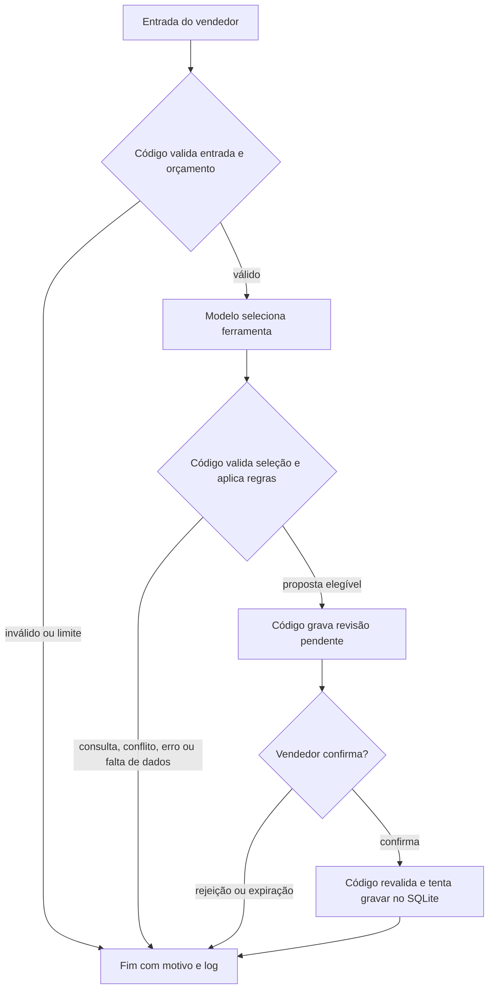

# Arquitetura v1 | decisão comercial

O LuxCar recebe o pedido do vendedor em linguagem natural e escolhe uma ferramenta.
O código verifica catálogo, disponibilidade, mínimo comercial e conflitos no SQLite.
Quando o pedido é elegível, prepara uma revisão que o vendedor pode confirmar ou rejeitar.
O sistema revalida antes da escrita e devolve o motivo final e o recibo, se houver.

## Autonomia

É um agente de autonomia limitada a uma escolha de ferramenta por mensagem, não um planejador aberto. Um formulário ou roteador determinístico é suficiente para pedidos estritamente padronizados, como demonstra o modo local. O modelo serve para interpretar pedidos livres e decidir quando não há contexto suficiente para executar a ferramenta. Em conflito com a referência validada pelo código, a escolha do modelo não autoriza gravação. A decisão que justifica esse desenho é distinguir uma consulta de disponibilidade de um pedido efetivo de abertura de proposta diante de ambiguidade. A política de elegibilidade não depende do julgamento do modelo.

| Ferramenta | Contrato | Leitura/escrita | Reversibilidade | Fonte/destino |
|---|---|---|---|---|
| `consultar_estoque` | ID → disponibilidade ou motivo | Leitura | Não se aplica | JSON de catálogo/estoque e tabela de propostas |
| `registrar_proposta` | ID + centavos → revisão, depois confirmação explícita → recibo | Escrita | Revisão rejeitável/expirável; proposta reversível administrativamente | SQLite, com revalidação dos JSONs |
| `encaminhar` | Motivo enumerado → orientação | Sem escrita de negócio | Não se aplica | Contrato local; gerente ou responsável pelo estoque conforme motivo |

Um pedido tem até cinco passos instrumentados, uma chamada ao provedor, timeout de 20 s, reserva de entrada e teto de 512 tokens de saída. A confirmação é um comando novo, sem chamada ao modelo. O log inclui o identificador da execução, modo, carimbo, uso reportado, resultado/erro por etapa e motivo de término. A rotina histórica de consulta/RAG permanece em `src.main`.
